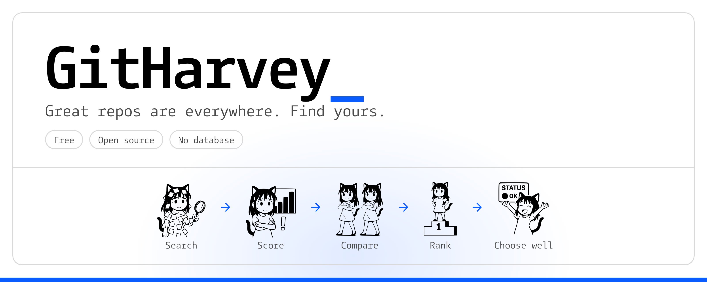

<p align="center">
  <picture>
    <source media="(prefers-color-scheme: dark)" srcset="docs/images/banner-dark.png">
    
  </picture>
</p>

<p align="center">
  <a href="LICENSE"></a>
  
  
  
  
</p>

GitHarvey helps you find the right GitHub repo for your goal. Tell it who you are and what you need, and get repos scored for health, with the reasons shown, and compared side by side. Free, open source, no database. Sign in with GitHub for read-only access to public data, or self-host on Vercel.

GitHub search ranks by stars and stops there. GitHarvey scores how healthy each repo is, shows how every point was earned, and lets you compare repos before you depend on one.

## How it works

1. **Sign in with GitHub.** One click in the navbar, and nothing to paste. GitHub asks you to approve read-only access to public information, and no permissions are requested. Signing in is required for Get Started, Compare and every results page.
2. **Answer four questions, or skip two.** Who you are, your goal, a topic (and optionally a language, from a list or typed in), and what matters most (one option, **All together**, ticks every priority at once). **Default mode** is the starting choice for the first two, and "Skip to search" goes straight to the topic.
3. **Review and confirm.** A last step shows your answers in plain words. Nothing is sent to GitHub until you press Confirm and search, and a "Searching GitHub…" message shows while the results load.
4. **Get ranked repos.** One GitHub search fetches the 30 best matches. GitHarvey scores them all and shows the healthiest first, 10 at a time.
5. **Look closer.** Open "Why this score", press Expand for extra facts, open a repo's details page, save it for later, or tick two or three repos and compare them side by side.

## Features

- **Health score, 0 to 100,** with a Healthy / Okay / Risky label. The word and number always appear, so colour is never the only signal.
- **"Why this score"** on every result: each signal, what was found, and the points it added.
- **Answers that change the search.** Audience sets the scoring weights. Goal and priorities change the query: recently updated, popular, beginner friendly (good first issues), permissive license.
- **Side-by-side comparison** of two or three repos, with the best value in each row marked and a data-only summary line. Copy it as Markdown or download it as CSV.
- **Also worth knowing,** facts that never change the score: open issues, license type (permissive, copyleft, restricted), codebase size hint, contributors, how fast pull requests get merged, a 52-week commit trend, good first issues and a rough dependency count.
- **Warnings in plain words** for archived repos and repos with no push in over a year, with a one-click **Find alternatives** search.
- **Sort, filter and tune.** Sort by health, stars or last push, filter by license and stars, or move four sliders to decide how much each signal counts. All in your browser, with no extra GitHub calls.
- **Save for later.** A shortlist kept in your browser (no account), with a Saved page you can compare from.
- **Repo details page** (`/repo/owner/name`) with the full breakdown, facts and trend chart, in a link that holds only the repo name.
- **Default mode.** Not sure who you are or what you want? Keep Default and just search, with balanced scoring.
- **Any language.** Pick from the list or type your own (Kotlin, Ruby, PHP, ...).
- **Quick start helpers.** "Try an example" and style chips (starter kit, boilerplate, tutorial, examples) on the start page.
- **Shareable links** for comparisons and for your results page. They hold repo names and your answers, never your token.
- **Your page** remembers your answers in your browser.
- **Keyboard shortcut:** press `/` to jump to the main input. The site follows your system's light or dark setting.
- **Sign in with GitHub, nothing to paste.** Everyone uses their own GitHub access, so there is no shared or host token and nobody can spend someone else's quota.
- **Return after sign-in.** After you sign in you land back on the page you asked for.

## Quick start

You need Node.js 20.9 or newer.

```bash
npm install
cp .env.example .env.local
openssl rand -base64 32      # paste the output after SESSION_SECRET= in .env.local
npm run dev
```

Open http://localhost:3000 and press **Sign in with GitHub**. Sign-in needs a GitHub OAuth app, which takes a minute to create:

### Create the GitHub OAuth app

1. On GitHub open Settings, Developer settings, OAuth Apps, **New OAuth App**.
2. **Homepage URL:** `http://localhost:3000`. **Authorization callback URL:** `http://localhost:3000/api/auth/github/callback`.
3. Register it, copy the **Client ID**, and press **Generate a new client secret**.
4. Put both in `.env.local`: `GITHUB_CLIENT_ID=...` and `GITHUB_CLIENT_SECRET=...`. Restart `npm run dev`.

For your live site make a second OAuth app with your own domain, and set the same two variables in Vercel (Project, Settings, Environment Variables). GitHarvey requests no scope, so it can only read public information. It rejects any token that carries permissions.

## Configuration

Set these in `.env.local` (or in your Vercel project). See [docs/self-hosting.md](docs/self-hosting.md).

| Variable | Required | Purpose |
|---|---|---|
| `SESSION_SECRET` | yes | 32 or more characters. Encrypts the sign-in cookie |
| `GITHUB_CLIENT_ID` | yes | Client ID of your GitHub OAuth app. Set it in `.env.local`, or in Vercel under Project, Settings, Environment Variables |
| `GITHUB_CLIENT_SECRET` | yes | The OAuth app's client secret. Server only: never prefix it with `NEXT_PUBLIC_` |
| `SITE_URL` | no | Your site address, for the social preview image |
| `REPO_URL` | no | Your repo address, for the GitHub link in the navbar and the footer links. Hidden when unset |

## Scripts

| Command | What it does |
|---|---|
| `npm run dev` | Start the dev server |
| `npm run build` / `npm start` | Production build and server |
| `npm run lint` | ESLint |
| `npm run typecheck` | TypeScript, strict mode |
| `npm test` | Vitest unit and component tests |
| `npm run e2e` | Browser tests (Playwright and Chrome) against the real app and a fake GitHub |

Run `npm run lint && npm run typecheck && npm test && npm run build` before you commit. CI runs the same checks, plus the browser tests, on every push.

## Project structure

```
src/app          pages (finder, compare, repo details, saved, start, my) and API routes (session, details, auth), robots, sitemap, social preview image
src/components   UI; landing/ holds the home page sections
src/lib          logic: scoring, query building, GitHub client, session, cache
src/__tests__    unit and component tests
e2e/             browser tests and a fake GitHub for them
fonts/           CamingoCode (text) and Catgirl System Font (pictures)
docs/            how scoring works, token safety, self-hosting, disclaimer
```

Files in `src/lib` that touch the token or GitHub start with `import "server-only"`, so they can never be bundled for the browser.

## Security

- The access token GitHub issues when you sign in is stored only in an encrypted `httpOnly` cookie (`Secure` in production, `SameSite=Lax`). It lasts 12 hours.
- The server sends it only to `https://api.github.com`. The browser never talks to GitHub.
- It is never logged, cached, or placed in a URL, response, or error message. Sign-in asks for no scope and checks a random one-time `state` that cannot be replayed. A test fails if `console.*` appears in `src/lib` or `src/app/api`.
- Signing out checks the `Origin` header, and the sign-in routes are rate limited.
- Only public GitHub data is cached, keyed by request path.
- No database, analytics, ads, or third-party scripts.

Details: [docs/token-safety.md](docs/token-safety.md).

## Deploy your own

Fork the repo and import it into Vercel, set `SESSION_SECRET`, `GITHUB_CLIENT_ID` and `GITHUB_CLIENT_SECRET` (and `REPO_URL` for the navbar and footer links), and deploy. Step by step, with a checklist: [docs/self-hosting.md](docs/self-hosting.md).

## How scoring works

Five signals (recent activity, license, docs, popularity, a release bonus), weighted by audience. Archived repos are capped at 20. Full rules and limits: [docs/how-scoring-works.md](docs/how-scoring-works.md).

## Tech stack

Next.js (App Router), React, TypeScript (strict), Tailwind CSS, iron-session, zod, and Vitest. No other runtime dependencies.

## Disclaimer

GitHarvey is not affiliated with GitHub, Inc. It calls the official GitHub API only after you act (sign in, search, compare, or press Expand), using your own read-only access. Scores are automated estimates from public data, not an audit or an endorsement, so read a repo's code and license before you depend on it. The repository is public and open source, so you can see exactly what is sent to GitHub. Full text: [docs/disclaimer.md](docs/disclaimer.md).

## Contributing

Issues and pull requests are welcome: see [.github/CONTRIBUTING.md](.github/CONTRIBUTING.md), the [code of conduct](CODE_OF_CONDUCT.md) and the [security policy](SECURITY.md). Keep changes small and targeted, keep components short with logic in `src/lib`, add tests for new logic, and do not add dependencies without discussing them first. Never add logging that could include the token or the client secret.

## License

Code: [MIT](LICENSE), copyright 2026 Bhargavi Badal. Fonts and dependencies have their own terms: see [NOTICE.md](NOTICE.md).
